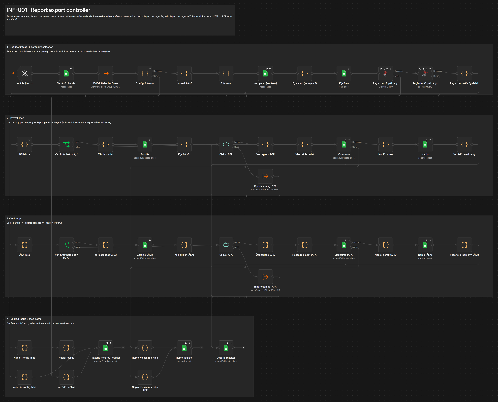
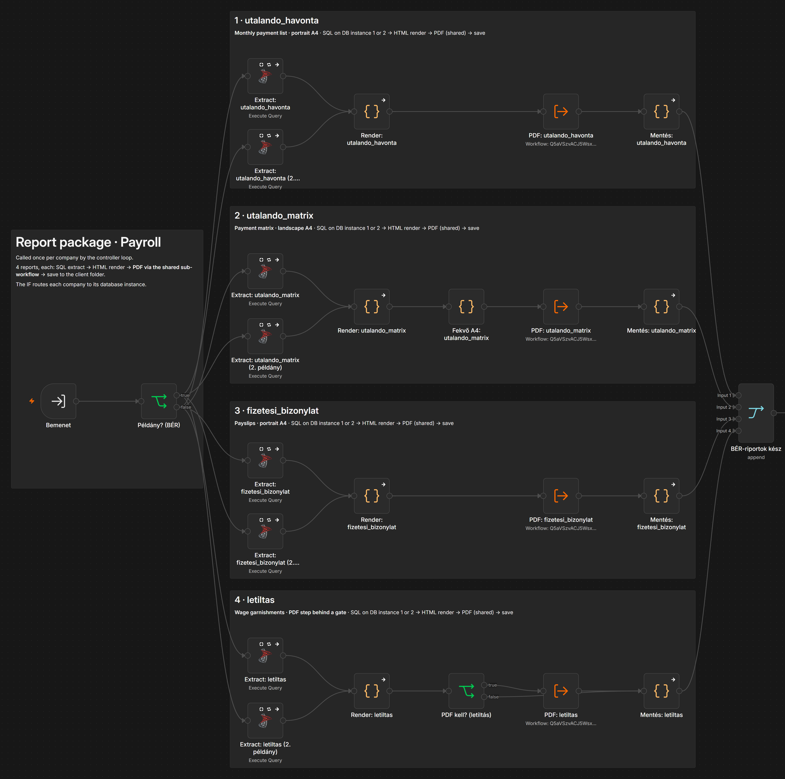
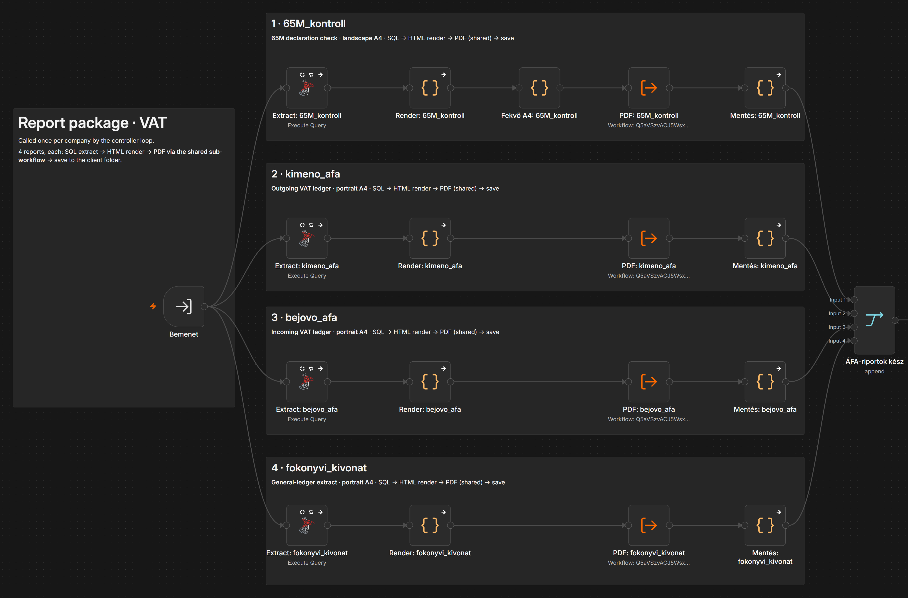
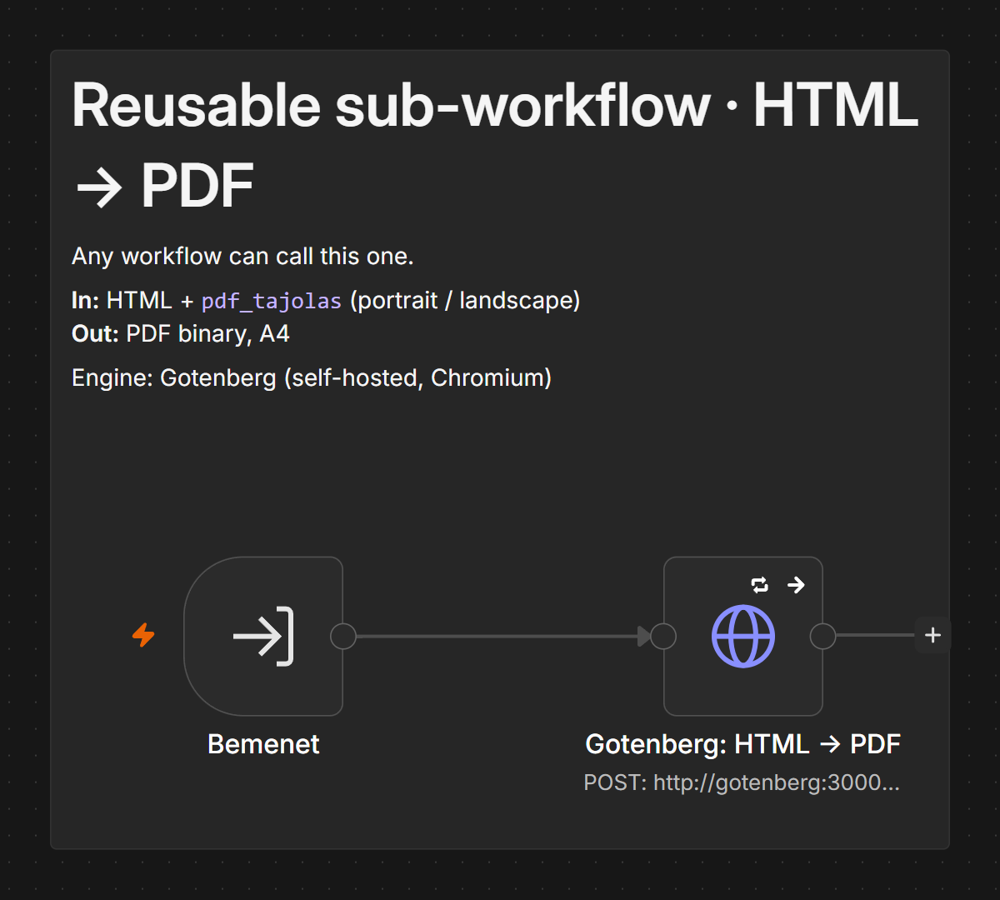
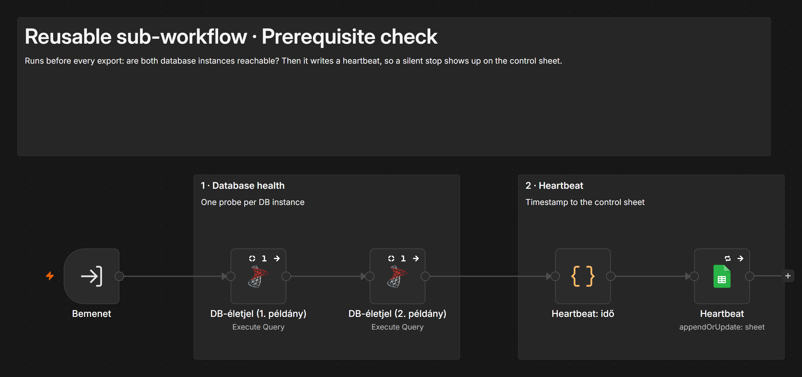

# Modular n8n report pipeline

An n8n report-export pipeline built for an accounting firm, split into a controller and four reusable sub-workflows. Every month it produces each client company's payroll and VAT reports from an on-premise SQL Server database, renders them to PDF and files them into each client's folder.

This repository shows the core payroll and VAT reports. Other documents the firm receives (for example tax-form files, or statements that go through a separate channel) are handled by separate workflows and are not included here.

The production version has run unattended since September 2026. This repository is a **sanitized copy** of its structure: node names, wiring, loops and sticky notes are real. Every SQL query, Code-node body, spreadsheet ID, credential and file path has been replaced with a stub. The production logic belongs to the client and is not published.

## Structure

| Workflow | What it does |
|---|---|
| `05-controller.json` | Polls a control sheet, runs the prerequisite check, takes a run lock, reads the client register, then loops over the companies for payroll and for VAT. Writes results back and logs every run. |
| `03-sub-report-package-payroll.json` | Called once per company. 4 reports, each: SQL extract → HTML render → PDF → save. Routes each company to its database instance. |
| `04-sub-report-package-vat.json` | Same pattern for the 4 VAT reports. Two of them need landscape A4. |
| `01-sub-html-to-pdf.json` | Shared by all 8 reports: HTML in, A4 PDF out (Gotenberg, portrait or landscape). Any other workflow can call it. |
| `02-sub-prerequisite-check.json` | Checks that both database instances answer, then writes a heartbeat so a silent stop is visible on the control sheet. |

The sub-workflows are connected with **Execute Workflow** nodes (`mode: each`, wait for completion). The report packages reference the loop item through their own trigger (`$('Bemenet')`, "input"), so they have no dependency on the controller's node names.

| Payroll package | VAT package |
|---|---|
|  |  |

| HTML → PDF | Prerequisite check |
|---|---|
|  |  |

Node names are in Hungarian, as in the client's environment; the sticky notes explain each section in English.

## Why split it

The original was one 89-node workflow. Splitting it gave:

- **One PDF step instead of eight.** A change to paper size or margins happens in one place, and new workflows reuse it.
- **A report package can be tested alone.** Give it one company and one period, check the 4 files.
- **The controller only orchestrates.** Request intake, locking, looping, write-back and logging, with no report logic in it.

## Lessons from production

1. **"Success" is not delivery.** n8n reported runs as successful while a file never arrived. A run now only counts when every expected file exists at its destination with the expected hash.
2. **Silent stops.** When the database or the VPN to the office dropped, nothing ran and nobody noticed. The heartbeat raises a freshness alert, and a VPN log check separates "our side" from "the office side".
3. **Rounding.** Figures were off by one unit. Every release now passes parity tests against the firm's own reports, including banker's-rounding cases.
4. **Diagnosis time.** A Claude-based diagnoser reads masked run evidence and classifies each failure as environment, code or transient; a second model tries to refute the diagnosis first. It is read-only: no SQL access, no writes.

## Importing

1. Run Gotenberg next to n8n (the PDF sub-workflow calls `http://gotenberg:3000`).
2. Import in this order: `01`, `02`, `03`, `04`, `05`.
3. In each Execute Workflow node, replace `REPLACE_WITH_ID_OF:<file>` with the ID n8n gave that sub-workflow.
4. Point the Google Sheets nodes at your own control sheet, and the SQL nodes at your own database and queries.

The stubs pass items through unchanged, so the workflows import and the wiring can be followed, but they produce no real reports until the SQL and Code nodes are filled in.

`tools/export_sanitized.py` produced these files from the live instance; `tools/leak_scan.py` checks them for e-mail addresses, paths, document IDs, tax numbers and client names before publishing.

## License

MIT
